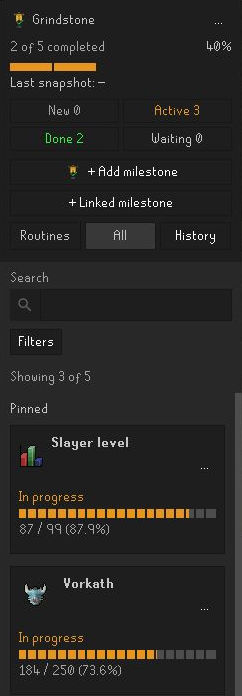
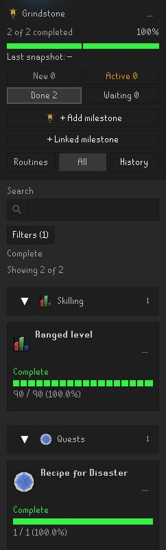
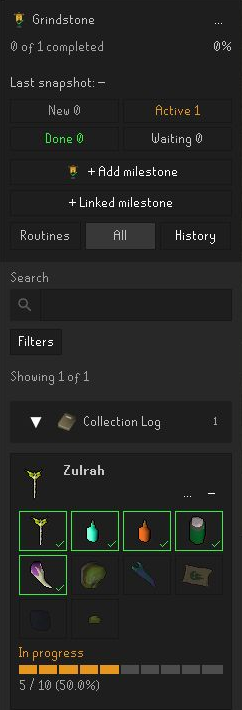
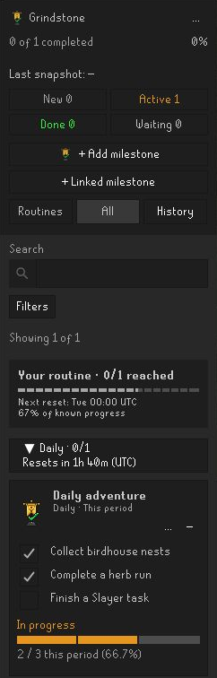
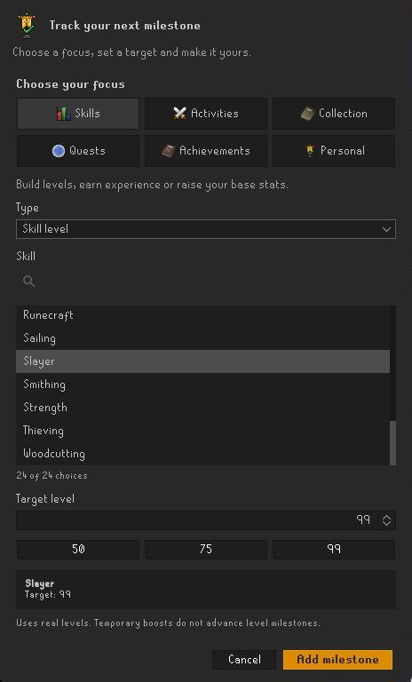

# Grindstone

**Your next level. Your next unlock. Your next milestone.**

Keep every Old School RuneScape grind in sight. Grindstone brings your skills, boss kills, collection log and personal milestones together in one RuneLite sidebar, with progress bars, item previews and completion alerts.

## A clearer view of your next milestone

Keep your priorities close and your progress easy to follow. Pin the grinds you care about, see what is already complete, and choose your next target without leaving RuneLite.

| Your priorities, at a glance | Milestones worth finishing |
| --- | --- |
|  |  |
| Keep your next skill and boss targets pinned at the top. | See finished milestones in green and revisit your progress in History. |

| Chase your missing collection slots | Make a little progress every day |
| --- | --- |
|  |  |
| See the items you have unlocked and the ones you are still chasing. | Check off your daily plans and see when the next period begins. |

*Screenshots show example milestones and progress.*

## Make every grind count

From your first skill milestone to your next collection-log slot, choose the targets that matter to you.

| Track | Set your sights on |
| --- | --- |
| **Levels & XP** | Skill levels, session XP, total level and XP, combat level, and base level and XP |
| **Bosses & activities** | Kill counts, raid and minigame completions, Slayer points and task streaks |
| **Quests & achievements** | Quests, quest series, diary tiers and Combat Achievements |
| **Collection log** | Individual unlocks or entire pages, with item previews and obtained progress |
| **Item quantities** | Supplies and equipment across known inventory, equipment, bank and supported storage |
| **Personal milestones** | Custom counters, notes, checklists and linked milestones |

Want to work toward the whole log? Use **Add all collection-log pages** from the header menu to add missing page milestones.

## Start your next milestone

1. Enable **Grindstone** in RuneLite, log in and open its sidebar.
2. Select **+ Add milestone**, choose what to track and set your target.
3. Review, save and play. Supported milestones update as you make progress.

Start with your own milestones or choose a preset pack from the **…** menu. Customize your sidebar, tracking preferences and alerts in **RuneLite settings → Grindstone**.

### Right-click to get started faster

Add a milestone straight from the game interface with the subject already selected.

| Right-click | Choose |
| --- | --- |
| A skill or Total level | **Set level milestone**, **Set XP milestone**, or a total/base target |
| Combat level in Combat Options | **Set combat milestone** |
| A quest | **Track quest** |
| An achievement diary region | **Track Easy/Medium/Hard/Elite diary** |
| A collection-log item or page | **Track unlock** or **Track page** |
| A Combat Achievement task | **Track task** |
| A Combat Achievements boss entry | **Track boss achievements** |
| A supported boss NPC | **Track kills** |

Choose your target and review it before saving. Each shortcut can be switched off in settings.

## Keep your priorities in focus

- **Put your next milestone first.** Pin milestones and group them by category or skill.
- **Find what matters now.** Search your milestones, filter the list or select a dashboard status counter.
- **Build a routine.** Create daily, weekly or monthly routines and use **Routines** to see recurring progress and upcoming resets.
- **Plan ahead.** Add personal deadlines and optional reminders in the sidebar.
- **Celebrate the finish.** Choose completion popups, local chat messages or optional desktop notifications, then revisit your milestones in **History**.
- **Manage your milestones together.** Use bulk actions to organize several milestones, and export a profile backup to keep a local copy.
