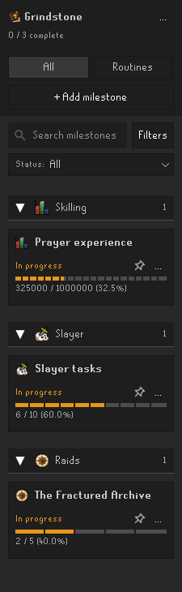
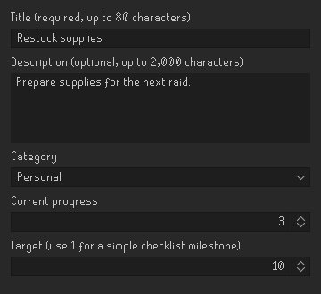
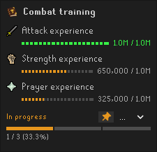
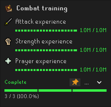
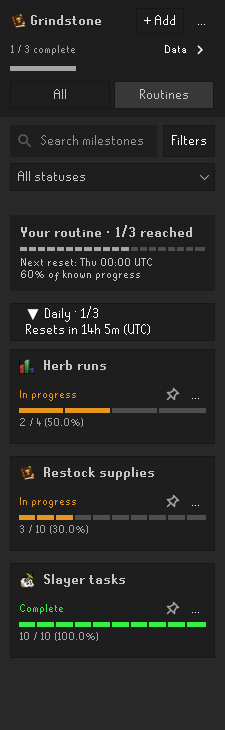
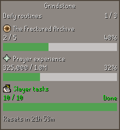
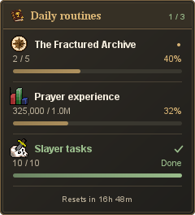
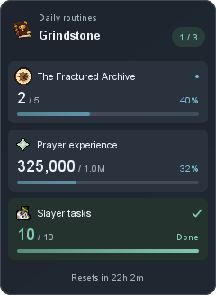
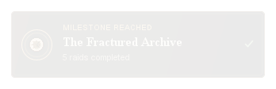

# Grindstone

**Your next level. Your next unlock. Your next milestone.**

Track skills, boss kills, collection-log unlocks, supplies and personal milestones in one RuneLite sidebar. Pin your priorities, build routines and celebrate completed targets.

## Your milestones

Search and filter by status, category, type or schedule. Pin important targets, group related skills, and expand cards for details and actions.

*Images show in-memory examples rendered with the current plugin components, not account data.*

## Get started

1. Enable **Grindstone**, log in and open its RuneLite sidebar.
2. Select **+ Add milestone**, choose a subject and set your target.
3. Save your milestone and play. Supported trackers update from available game data.

Track levels and XP, bosses and activities, quests and diaries, Combat Achievements, collection-log unlocks and owned items. Personal milestones support manual counters, notes and checklists; groups combine existing milestones.

Right-click supported skills, quests, diary regions, collection-log entries, Combat Achievements or boss NPCs to start with the subject selected. Each shortcut can be disabled in settings.

### Personal targets

Set a target and update your own progress. Use the card's **+1**, **Set progress** or checklist controls where available.

### Milestone groups

Open **… → Add group…**, name your group and select existing milestones with their targets. Expand the group to see each milestone's icon and progress bar alongside the combined progress.

This **Combat training** group has one of three XP targets complete.

When all three targets are reached, the group is complete.

## Daily, weekly and monthly routines

Create repeating milestones or add a routine preset from the **…** menu. The **Routines** view shows period progress and upcoming UTC resets. Observed periods remain available in **History**.

Add personal deadlines and optional reminders without changing the game's reset schedule. In **RuneLite settings → Grindstone → Notifications**, choose completion alerts, routine reminders, chat messages and optional desktop notifications.

## Progress beside the game

Enable **RuneLite settings → Grindstone → Progress overlay**. Choose daily routines, all routines, milestones, pinned entries or all tracked. Hold **Alt** and drag to reposition it. Adjust the entry limit and progress bars in settings.

### RuneLite — default

### Guild

### Slate

Classic is also available. The progress overlay is optional; completion popups always use Guild.

### Completion popups

Newly reached targets appear together in a compact Guild popup. Entry and exit animations can be configured in Notifications. Completion chat colors adapt to RuneLite's chat background, and exact progress numbers can be switched off.

## Saved progress and game data

Sign in to the same RuneLite account on each computer to sync your character's milestones, history and snapshots. RuneLite uses its normal sync schedule. Local recovery copies and manual backups remain available through the **…** menu; milestone packs share definitions without account progress or history.

Open **… → Game data** for capture status and refresh instructions. Bank and other storage snapshots retain their last known contents; reopen storage after playing on another device.

Before adding collection-log milestones, open your in-game collection log and check its capture status in **Game data**. Grindstone verifies loaded unlocks against the game's total; incomplete data may require refreshing the log. **Add all collection-log pages** adds missing page milestones.

Played on mobile or another computer? **Since last seen** summarizes changes from the previous saved reading. Exact achievement times and gains across routine resets cannot be reconstructed.
