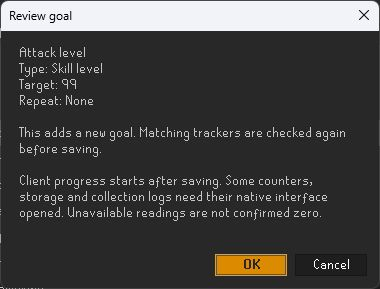

# Grindstone

Turn your next Old School RuneScape grind into a clear goal. Track skills, boss kills, collection-log unlocks and personal routines in one RuneLite sidebar.

## Getting started

With the plugin enabled:

1. Log in and open **Grindstone** from the RuneLite sidebar.
2. Select **+ Add goal**, choose what to track and set your target.
3. Review and save your goal, then watch its progress as you play.

New profiles start empty. Open the header's **…** menu for goal presets, daily and weekly routine packs, bulk actions and profile backups. Adjust appearance, goal types and notifications in **RuneLite settings → Grindstone**.

## What you can track

| Goal type | Examples |
| --- | --- |
| Skills | Skill level and XP, session XP, total level and XP, combat level, base level and XP |
| Activities | Boss kills, raid and minigame completions, Slayer points and task streaks |
| Unlocks | Quests and quest series, achievement diaries, Combat Achievement tasks and tiers |
| Collection log | Individual item unlocks and page completion, with item icons and obtained progress |
| Owned items | Target quantities across known inventory, equipment, bank and supported storage |
| Personal goals | Manual progress, notes, checklists and linked goals built from existing trackers |

Make goals daily, weekly or monthly, add personal deadlines, and browse past completions in **History**. Completion alerts include a popup, a local chat message and optional desktop notifications.

## Keep your goals organized

- Pin your priorities and group related goals by category or skill.
- Search titles, descriptions and categories; filter by status, type, schedule or pinned goals.
- Select a dashboard status counter to show new, active, completed or waiting goals.
- Switch to **Today** to focus on recurring goals and their next resets.
- Use a goal's actions menu to edit or delete it, or manage several goals through **Manage goals / bulk actions**.
- Export a local profile backup or import missing goals without replacing existing targets.

The header menu also offers **Add all collection-log pages** to create missing page goals from the client's collection-log catalogue.

## Add goals from the game interface

Right-click a supported entry to open a goal editor with the subject already selected. Choose your target and review it before saving.

| Right-click | Available goals |
| --- | --- |
| A skill in the Skills tab | Skill level or XP |
| Total level in the Skills tab | Total level, total XP, base level or base XP |
| Combat level in Combat Options | Combat level |
| A quest in the quest list | Quest completion |
| An achievement diary region | Easy, Medium, Hard or Elite diary completion |
| A collection-log item or page | Item unlock or page completion |
| A Combat Achievement task | Task completion |
| A supported boss NPC | Kill count |
| A Combat Achievements boss entry | Boss-task completion |

Shortcuts can be disabled in Grindstone's settings. They open the editor and perform no game actions.

## Screenshots

| Dashboard and progress | Choose a goal |
| --- | --- |
|  |  |

| Collection-log goals | Review before saving |
| --- | --- |
|  |  |

## How tracking works

Progress uses information available to your logged-in client. Some goals need you to open the relevant game interface before a reading is available. A **waiting** goal needs a login or a client reading; it does not mean your progress has been lost.

Owned-item goals use known storage contents. Normal and noted quantities are combined; bank placeholders are excluded. Collection-log dates show when Grindstone first observed an unlock.

Personal routines reset at UTC day, week or month boundaries. These schedules track your chosen routines; offline progress across a reset may not be attributable to the correct period.

Profiles and backups stay local. Grindstone does not automate gameplay or send chat messages to other players.
